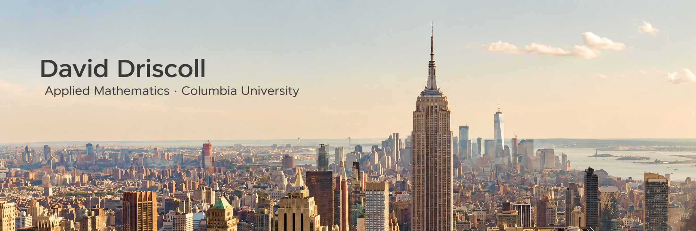
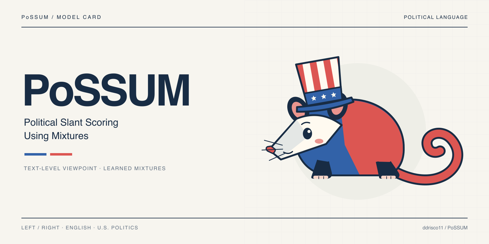
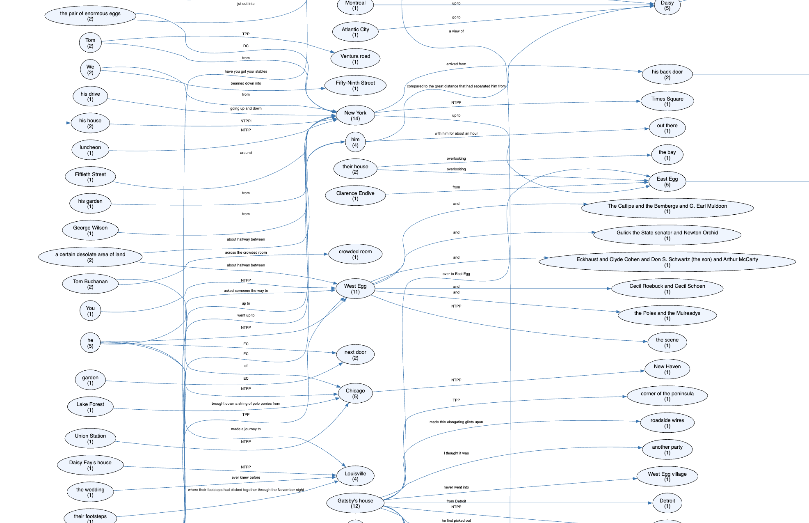
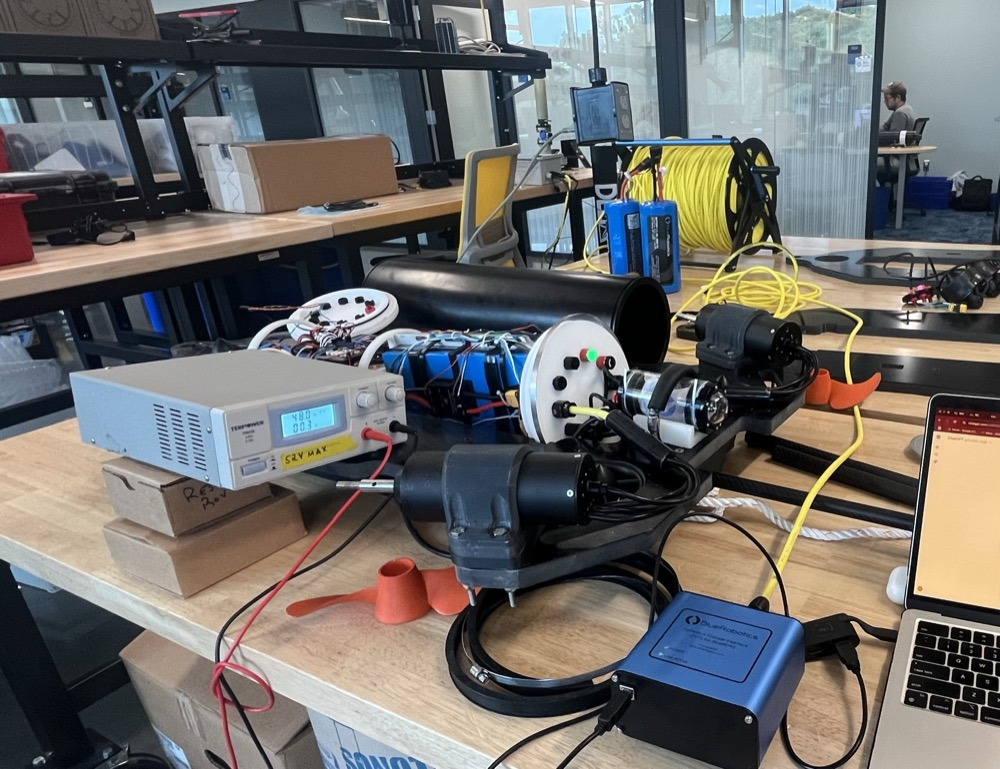
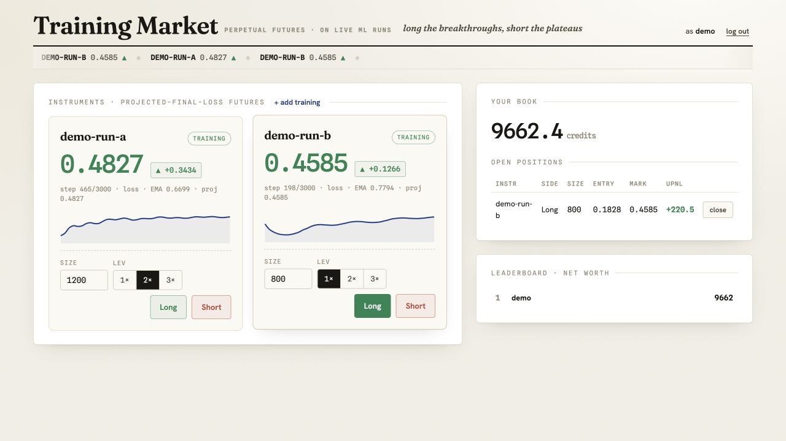

  

### Hi, I’m David.

I’m an **Applied Math student at Columbia University**, originally from **Winchester, Massachusetts**.

My projects explore machine learning, the geometry of embeddings, and computer vision for underwater robotics.

## Projects

<table>
  <tr>
    <td width="190" align="center">
      
    </td>
    <td>
      <strong><a href="https://github.com/ddrisco11/PoSSUM">PoSSUM</a></strong> 
      Political Slant Scoring Using Mixtures: comparing language models and model mixtures for political viewpoint classification.
    </td>
  </tr>
  <tr>
    <td width="190" align="center">
      
    </td>
    <td>
      <strong><a href="https://github.com/ddrisco11/Spatial-Graph-Pipeline">Spatial Graph</a></strong> 
      An ISO-Space pipeline for mapping spatial relationships in prose into graphs, including expressions beyond conventional place names.
    </td>
  </tr>
  <tr>
    <td width="190" align="center">
      
    </td>
    <td>
      <strong><a href="https://github.com/ddrisco11/chase_api">Chase API</a></strong> 
      Vision-based object tracking and motor control for autonomous underwater vehicles, developed at the Woods Hole Oceanographic Institution.
    </td>
  </tr>
  <tr>
    <td width="190" align="center">
      
    </td>
    <td>
      <strong><a href="https://github.com/ddrisco11/training-market">Training Market</a></strong> 
      A play-money trading prototype for ML training runs, with prices derived from projected training metrics, simulated positions, and a live leaderboard.
    </td>
  </tr>
</table>

## Companies & labs I’ve worked with

- **[Columbia Software Solutions](https://www.columbiasoftwaresolutions.com/)** — Head of Growth · Sep 2026–present. Leading a team of forward-deployed engineers building custom software and AI solutions for nonprofits and scientific labs.
- **[Raylu](https://raylu.ai/)** — Intern · Dec 2025–Sep 2026. Open-source ML engineering, hybrid vector embeddings, and GPU orchestration; built a company search engine now served in production.
- **[Columbia Narrative Intelligence Lab](https://nil.columbia.edu/)** — Independent Study · Jan–May 2026. Spatial graph research advised by Dr. Dennis Yi Tenen.
- **[The Woods Hole Oceanographic Institution](https://www.whoi.edu/)** — Engineering Assistant · Aug–Sep 2025, working on autonomous submarine software with [Applied Ocean Physics & Engineering](https://www.whoi.edu/department/applied-ocean-physics-engineering/) and the [National Deep Submergence Facility](https://ndsf.whoi.edu/about-ndsf/). Previously a Guest Student (Jun–Sep 2024) and Intern (Jun 2022–May 2024) in the [Shank Molecular Ecology & Evolution Lab](https://www.whoi.edu/what-we-do/understand/departments-centers-labs/labs-groups/labs-groups-by-department/), working on computer vision, GIS, DNA extraction, and data analysis.
- **[Great Gray Trust Company](https://greatgray.com/)** — Intern · May–Jul 2025. Machine learning for finance, predictive modeling, workflow automation, and data analysis.
- **[Vanderbilt Biomedical Data Representation and Learning Lab](https://hrlblab.github.io/)** — Researcher · Dec 2024–May 2025. Fine-tuning computer vision models for deep-ocean imagery, advised by Dr. Yuankai Huo.
- **[Castle Island Ventures](https://castleisland.vc/)** — Intern · Mar–May 2024. Investment research and pitches focused on NFT marketplaces, off-ramps, and Telegram trading bots.

---

[LinkedIn](https://www.linkedin.com/in/david-driscoll-977a8422a/) · [Hugging Face](https://huggingface.co/ddriscoll) · [Email](mailto:david.driscoll@columbia.edu)

[Explore my repositories →](https://github.com/ddrisco11?tab=repositories)
