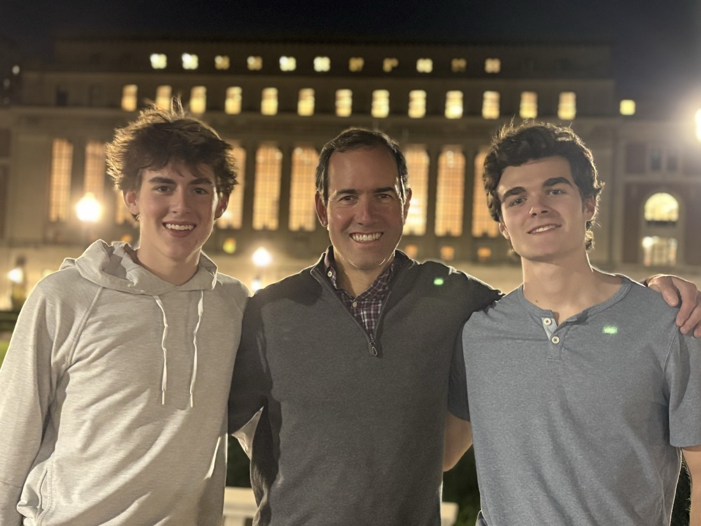

  

### Hi, I’m David.

I’m an **Applied Math student at Columbia University**, originally from **Winchester, Massachusetts**.

Welcome to my corner of GitHub.

  
  
  

## Currently working on

### [PoSSUM](https://github.com/ddrisco11/PoSSUM)
Political Slant Scoring Using Mixtures — modular political viewpoint classification.

### [Geometry of Harmful LLM Outputs](https://github.com/ddrisco11/geometry-of-harmful-llm-outputs-for-alignment)
Exploring harmful-output geometry with frozen embeddings, controlled category analysis, and classification benchmarks.

### [Probabilistic Retrieval Fields](https://github.com/ddrisco11/probabilistic-retrieval-fields)
Relevance-trained routing over frozen embeddings, with reproducible retrieval experiments and an interactive explorer.

---

[Explore my repositories →](https://github.com/ddrisco11?tab=repositories)
