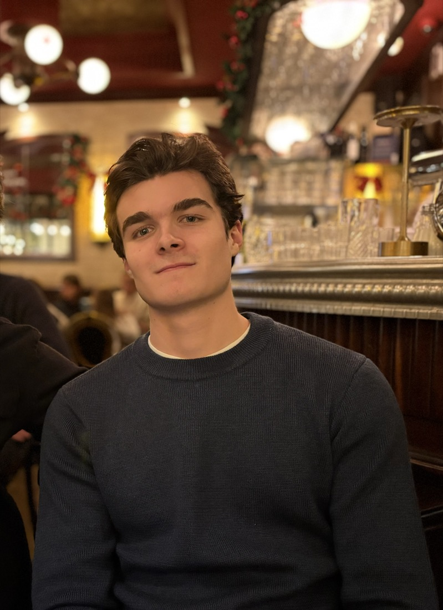
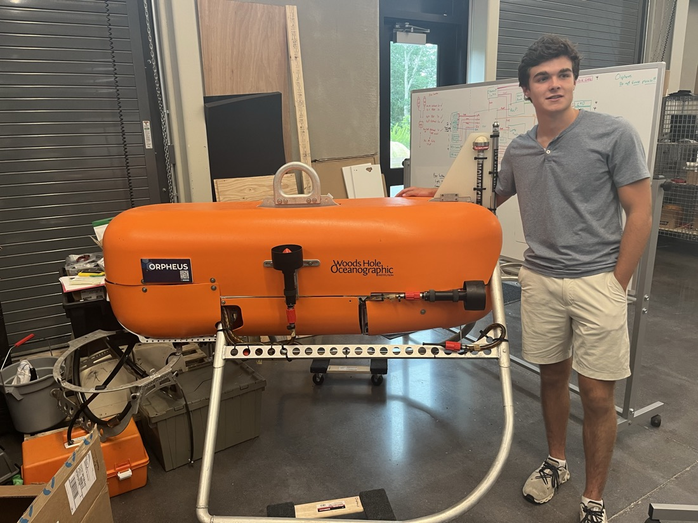

  

### Hi, I’m David.

I’m an **Applied Math student at Columbia University**, originally from **Winchester, Massachusetts**.

My projects explore machine learning, the geometry of embeddings, and computer vision for underwater robotics.

  
  

## Currently working on

### [PoSSUM](https://github.com/ddrisco11/PoSSUM)
Comparing individual language models and model mixtures for political viewpoint classification. Explore the evaluation results and the tradeoffs between prediction quality and inference cost.

[Evaluation and limitations →](https://github.com/ddrisco11/PoSSUM#development-comparison)

### [Probabilistic Retrieval Fields](https://github.com/ddrisco11/probabilistic-retrieval-fields)
Can a small neural router find relevant answers without retraining the embedding model? Use the interactive explorer to compare retrieval quality against how much of the corpus is searched.

[Try the explorer →](https://ddrisco11.github.io/probabilistic-retrieval-fields/)

## Selected earlier work

### [Chase API · Underwater robotics](https://github.com/ddrisco11/chase_api)
A vision-based control system that turns object detections into motor commands for an autonomous underwater vehicle. Built during my summer 2025 work at Woods Hole Oceanographic Institution.

[See how it works →](https://github.com/ddrisco11/chase_api#how-it-works-in-practice)

---

[LinkedIn](https://www.linkedin.com/in/david-driscoll-977a8422a/) · [Hugging Face](https://huggingface.co/ddriscoll) · [Email](mailto:david.driscoll@columbia.edu)

[Explore my repositories →](https://github.com/ddrisco11?tab=repositories)
