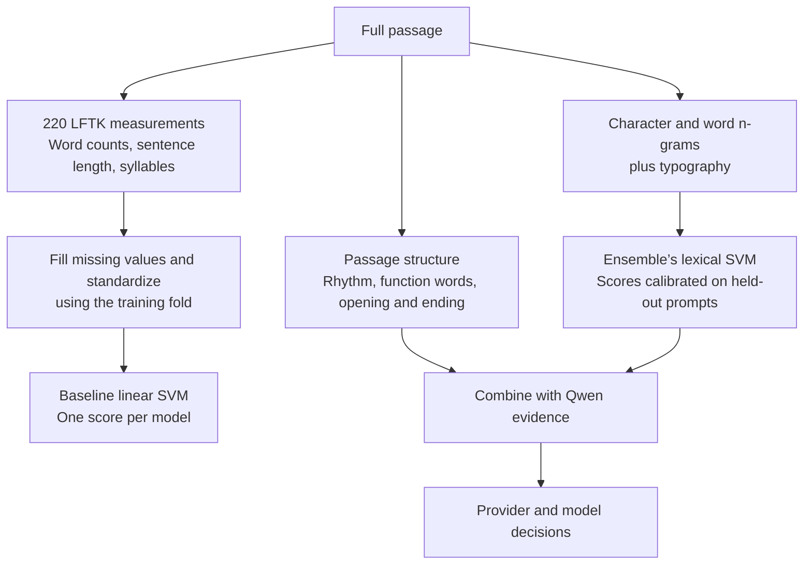
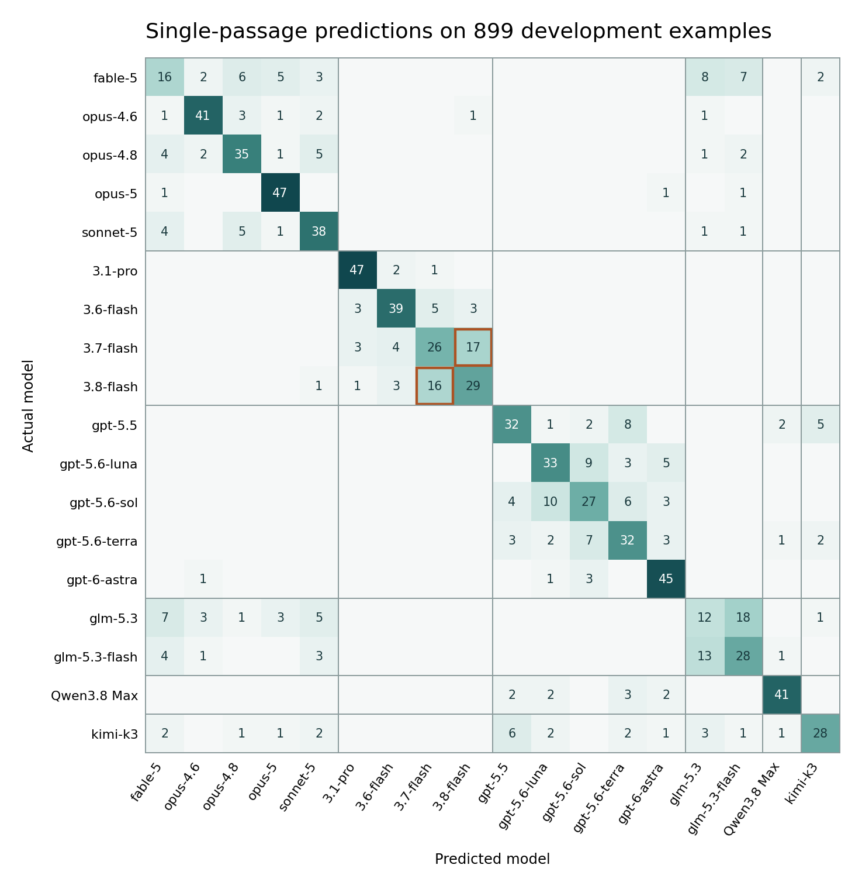
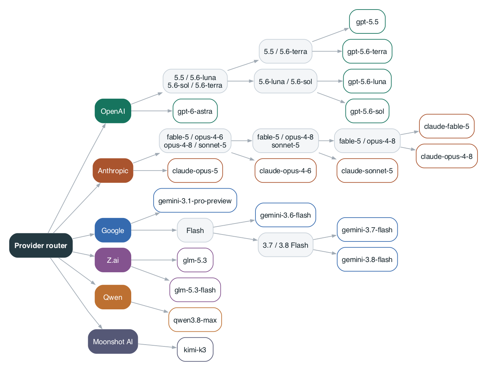

# Name That LLM

In Kaggle’s *Name That LLM*, 18 language models from six providers answer questions about topics ranging from physics to creative writing. The training set includes the author of each paragraph. On the hidden test set, I get the passage text and an ID, and I have to predict the exact model that wrote it. Recognizing Google’s style gets me only partway there. A paragraph from Gemini 3.7 Flash earns credit only if I can distinguish it from Gemini 3.8 Flash and the other 16 models. I built my classifier around those two decisions. [Competition overview](https://www.kaggle.com/competitions/name-that-llm/overview)

My first provider-first ensemble scored **0.619 balanced accuracy on the public leaderboard**. Balanced accuracy gives each model equal weight by averaging its recall. I used that metric throughout because a classifier could otherwise gain ground on a common model while getting worse on a rare one.

## What I could learn from writing style

I started with 2,699 labeled passages responding to 150 prompts. I kept whole prompts together when splitting the data. If answers to the same question appeared on both sides of a split, shared vocabulary could make the attribution task easier than it would be on a new question.

| Input to a linear SVM | Balanced accuracy on held-out prompts |
|---|---:|
| Character sequences from the opening sentence | 0.134 |
| 220 linguistic features from the full passage | 0.233 |
| Character sequences from the full passage | 0.311 |

The 220-feature baseline put each passage into the same numerical coordinates. For example, “words per sentence” captures a different habit from “syllables per word.” I filled missing values with the training-fold medians and standardized each feature. The linear support vector machine (SVM) learned a weighted sum of the features for each of the 18 authors and picked the highest score. [Bruce W. Lee and Jason Lee, *LFTK: Handcrafted Features in Computational Linguistics* (2023)](https://aclanthology.org/2023.bea-1.1/) · [Corinna Cortes and Vladimir Vapnik, *Support-Vector Networks* (1995)](https://doi.org/10.1007/BF00994018)

The character SVM gained almost 18 percentage points when I gave it the whole passage instead of just the opening sentence. I kept character and word patterns in the ensemble’s lexical SVM. The tree also gets separate measurements of punctuation, sentence rhythm, and how the opening differs from the ending.

## Reading the mistakes

Each cell counts passages. The diagonal contains correct predictions, blank cells represent zero, and the thin lines separate providers. Read across the Gemini 3.7 Flash row. **17** passages landed in the 3.8 Flash column. Reading the other way gives **16** more errors. A classifier could recognize the right provider on all 33 and still miss the exact model every time. This matrix records the provider-first baseline on development prompts, before I added the specialist tree.

## From a provider to an exact model

I used public task-trained Qwen adapters to extract evidence from a passage, then fitted a router and specialist classifiers around those representations. To design the branches, I measured which labels the development model confused with one another. That gave closely matched pairs, including the two Gemini Flash versions, their own decision. Each of the 12 splits has a ridge classifier trained on the labels on either side of that split.

One experiment helped me decide how much authority to give a specialist. I trained extra classifiers on punctuation, function words, and paragraph openings and endings for two difficult pairs. Overriding the tree on those pairs fixed **23** previously incorrect predictions and broke **26** correct ones. I left the overrides out.

## Where the tree helped

I compared the first provider-first model with the specialist tree on two separate panels of 15 prompts each. Each prompt had responses from all 18 models. I replayed each panel with 18, 9, 3, or just 1 response per prompt available at inference. The classifier inferred related passages from their text.

| Evaluation | First provider-first model | With the specialist tree |
|---|---:|---:|
| Reserved panel, weighted mix | 0.653 | **0.668** |
| Confirmation panel, weighted mix | 0.660 | **0.670** |
| Confirmation panel, all 18 responses available | 0.674 | **0.696** |
| Confirmation panel, one response available | **0.656** | 0.644 |

The last two rows explain why I track the mix. Comparing answers to the same question helped the tree distinguish writers. Given a lone passage, the earlier model did better. For the weighted rows I assigned 15%, 25%, 30%, and 30% to the four group sizes. Kaggle keeps the hidden mix private. Both panels had also informed earlier baseline work, so I treat the improvements as local comparisons.

## The 27B experiment

I kept the tree topology and replaced the five primary 8B adapter passes with one pass through a public task-adapted Qwen3.8-27B. Every specialist can reuse that pass. A separately fitted classifier on Qwen3-Embedding-8B contributes a second set of model scores. The offline Kaggle notebook fits the downstream heads and writes one exact model label per test ID.

The released 27B adapter had already trained on all 2,699 official passages. Holding out some of those passages afterward would give a misleading estimate of the adapter’s performance. The 0.619 leaderboard result above belongs to the earlier ensemble. [Original 8B adapter by prvsiyan](https://www.kaggle.com/datasets/prvsiyan/ntl-qwen3-8b-lora24-two-stage-adapters/versions/4) · [27B inference release by Vladislav Lavrentev](https://www.kaggle.com/code/lightningv08/0-681-qwen3-embedding-lora-qwen3-8-27b)

Competition artwork courtesy of Kaggle. [Original banner](https://www.kaggle.com/competitions/170484/images/header)
